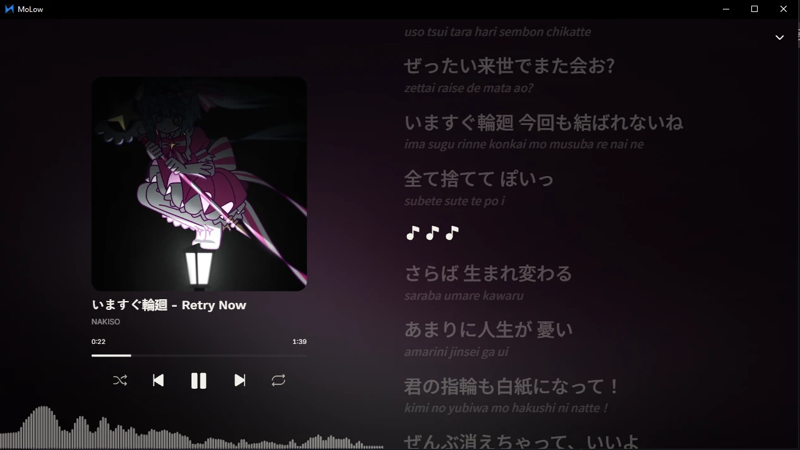
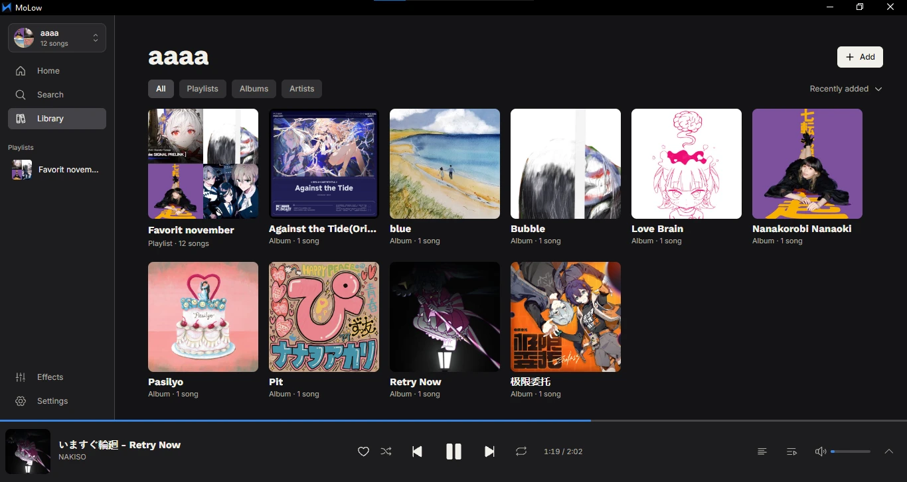

<p align="center">
  
</p>

<h1 align="center">MoLow</h1>

## Contents

- [What is this?](#what-is-this)
- [Project state](#project-state)
- [Screenshots](#screenshots)
- [Codec and container support](#codec-and-container-support)
- [Downloads](#downloads)
- [Developing](#developing)
- [Stack](#stack)
- [Acknowledgements](#acknowledgements)
- [License](#license)

## What is this?

MoLow is a feature-rich yet lightweight audio player. It
plays most common audio formats and codecs (see the
[codec support table](#codec-and-container-support)).

It covers the basics of an audio player like playback control, parsing and
loading local songs from a single file or a folder. It can also stream music
directly from online music libraries notably YouTube Music through
[ytm-go](https://github.com/dlcuy22/ytm-go) and network, and it supports system media
protocols such as MPRIS2 and SMTC.

MoLow is cross-platform. The library behind it,
[molo](https://github.com/dlcuy22/molo), is built with portability in mind, and
the UI is built with [Wails](https://v3.wails.io), which makes building for
other platforms straightforward (an Android version is coming soon).

MoLow is extensible: you can write your own effects in Lua through its Effects
API. Some of the effects bundled in `backend/effects/` are written in Lua, and
it also ships built-in effects written in Go, EQ among them.

## Project state

MoLow is at its earliest stage of development. We spent our time building a
ready-to-use audio library before focusing on this UI implementation.

The current UI is functional and every control is in place, but it is still not
perfect, and I am working on it.

## Screenshots

<p align="center">
  
</p>

<p align="center">
  
</p>

## Codec and container support

| Name | Support | Note |
| --- | :---: | --- |
| MP3 | Yes | MPEG-1/2/2.5 Layer III |
| FLAC | Yes | Lossless, 16 and 24-bit |
| WAV | Yes | Integer PCM 8/16/24/32-bit and IEEE float 32/64-bit |
| Opus (`.opus`, `.ogg`) | Yes | Pure Go; the optional `libopusfile` path seeks faster |
| AAC (`.aac`) | Yes | AAC-LC in ADTS |
| M4A / MP4 | Yes | AAC-LC only |
| Ogg Vorbis | No | Only Ogg Opus is read |
| ALAC | No | Not implemented |
| WebM / Matroska | Yes | Opus audio only |
| AIFF | No | Not implemented |
| WMA | No | Not implemented |
| APE | No | Not implemented |
| DSD (`.dsf`, `.dff`) | No | Not implemented |

Special thanks to [tphakala](https://github.com/tphakala) for providing most of
the codec implementations in pure Go.

Every format is normalized to 48 kHz stereo float32 before it reaches the audio
device, so one output stream serves every track.

## Downloads

MoLow will not publish any executable or installer on the releases page until it
reaches a stable branch. The project is still unstable and unfinished, so we
will publish builds only when they are ready.

## Developing

First, make sure the [Wails 3 tooling](https://v3.wails.io/quick-start/installation/)
is installed on your system, and then install [Bun](https://bun.com/docs/installation).

If you are not familiar with Wails 3, I strongly suggest reading its
[beginner tutorial](https://v3.wails.io/tutorials/03-notes-vanilla/) to
understand the basics.

If you don't have time to read any of those, follow these steps:

1. **Install Go:** Download and install from [go.dev/dl](https://go.dev/dl/), or install it through your package manager on Linux.

2. **Install Bun:**

   On Linux / macOS:

   ```sh
   curl -fsSL https://bun.sh/install | bash
   ```

   On Windows (PowerShell):

   ```powershell
   irm bun.sh/install.ps1|iex
   ```

3. **Install the Wails 3 tooling:**

   On Linux, install the required system packages from your package manager first: `gcc`, `pkg-config`, `gtk4-devel`, `webkitgtk6.0-devel`.

   Then install the CLI, run setup, and verify your installation:

   ```sh
   go install github.com/wailsapp/wails/v3/cmd/wails3@latest
   wails3 setup
   wails3 doctor
   ```

Done.

## Stack

- **Backend:** Go with Wails framework
- **Scripting language:** Lua
- **Frontend & Tooling:** TypeScript + Tailwind CSS + Svelte 5 + Vite + Bun

## Acknowledgements

- [ytm-rs](https://github.com/grapedjuice/ytm-rs) (GPL-3.0-only): the animated album-art backdrop shader in `frontend/src/lib/backdrop-gl.ts`, its WebGL2 player host in `frontend/src/lib/components/PlayerBackdrop.svelte`, and the 64x64 blurred cover pipeline in `internal/artwork/backdrop.go` are ported from ytm-rs.
- [Better Lyrics](https://github.com/better-lyrics) (MIT): creators of Kawarp, the animated backdrop effect that ytm-rs's shader is based on.
- [tphakala](https://github.com/tphakala): pure Go audio codec implementations.

## License

Copyright (C) 2026 Asrian Putra.

MoLow is released under the [GNU General Public License v3.0](LICENSE) (`GPL-3.0-only`).

Third-party licenses and notices, including ytm-rs (GPL-3.0-only), Kawarp from Better Lyrics (MIT), `go-aac` (LGPL-2.1-or-later), and `ebitengine/oto` (Apache-2.0), are listed in [NOTICE](NOTICE). The standalone [molo](https://github.com/dlcuy22/molo) audio engine remains under the MIT License.
